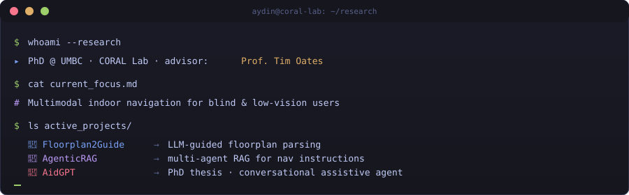
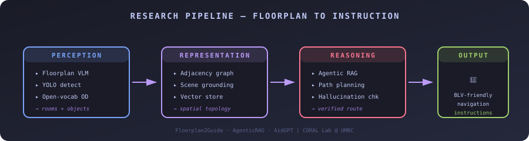

<!--
═══════════════════════════════════════════════════════════════════════════════
  Aydin Ayanzadeh — GitHub Profile
  PhD · Computer Science · UMBC · CORAL Lab
  Theme: Tokyo Night  ·  Custom SVG widgets in ./assets/
═══════════════════════════════════════════════════════════════════════════════
-->

<!-- ─── HEADER WAVE ────────────────────────────────────────────────────────── -->

<!-- ─── TYPING SVG (URL-safe encoding) ─────────────────────────────────────── -->

  

<!-- ─── SOCIAL BADGES ──────────────────────────────────────────────────────── -->

  
  
  
  
  
  

---

<!-- ─── TERMINAL CARD (custom, hosted in this repo — never breaks) ─────────── -->

  

---

### 🔬 Research Pipeline

<!-- ─── CUSTOM PIPELINE DIAGRAM (custom SVG, hand-designed for your work) ──── -->

  

> **Perception** extracts rooms, doors, and objects from raw floor plans using VLMs and YOLO-based detectors. **Representation** turns that into a navigable spatial graph plus a retrieval store. **Reasoning** uses agentic RAG to plan routes and verify them against hallucination. The output is a natural-language route a blind or low-vision user can actually follow.

---

### 🚀 Active Projects

<table>
<tr>
<td width="50%" valign="top">

#### 🗺️ Floorplan2Guide
LLM-guided floor plan parsing for indoor BLV navigation.
- **Venue:** IEEE Big Data 2025 · [arXiv:2512.12177](https://arxiv.org/abs/2512.12177)
- **Follow-on:** *LLM-Guided Agentic Floor Plan Parsing* — **CVPR 2026**
- **Stack:** `VLMs` `NetworkX` `LangChain`
- Decomposes floorplan understanding into agent sub-tasks (rooms, doors, adjacency) for grounded path queries.

</td>
<td width="50%" valign="top">

#### 💬 AidGPT
PhD thesis — conversational assistive agent for BLV users.
- **Related:** *On-Device Depth-Aware Multimodal Workload* — **IISWC 2026**
- **Stack:** `PyTorch` `Multimodal LLMs` `Speech`
- Real-time multimodal dialogue grounded in physical environment context, characterized for on-device deployment.

</td>
</tr>
<tr>
<td width="50%" valign="top">

#### 🔭 InVLM / AgenticRAG
Parameter-efficient VLM adaptation + multi-agent RAG for navigation instructions.
- **Stack:** `PEFT` `Qwen2-VL` `LangGraph` `🤗 Transformers`
- Specialist agents (planner, verifier, instructor) coordinate to suppress hallucination in safety-critical routing.
- **Project page:** [Indoor Navigation](https://www.ayanzadeh.com/projects/indoor-navigation.html)

</td>
<td width="50%" valign="top">

#### 🔥 WildfireVLM
AI-powered early wildfire analysis from satellite imagery.
- **Venue:** IGARSS 2026 · [arXiv:2602.13305](https://arxiv.org/abs/2602.13305)
- **Related:** *Modular Mechanisms for Auditable Wildfire Spread* — [arXiv:2609.17763](https://arxiv.org/abs/2609.17763)
- **Project page:** [WildfireVLM](https://www.ayanzadeh.com/projects/wildfire-vlm.html)

</td>
</tr>
</table>

---

### 🛠 Tech Stack

  

  
  
  
  
  
  
  

---

### 📄 Selected Publications

<table>
<tr><td>🗺️</td><td>

**LLM-Guided Agentic Floor Plan Parsing for Accessible Indoor Navigation of Blind and Low-Vision People**
*A. Ayanzadeh, T. Oates, et al.* — **CVPR 2026** (accepted)

</td></tr>
<tr><td>📱</td><td>

**Characterizing an On-Device Depth-Aware Multimodal Workload in Assistive Navigation for BLV Users**
*A. Ayanzadeh, et al.* — **IISWC 2026** (accepted)

</td></tr>
<tr><td>🛰️</td><td>

**WildfireVLM: AI-Powered Analysis for Early Wildfire Detection Using Satellite Imagery**
*A. Ayanzadeh, et al.* — **IGARSS 2026** · [arXiv:2602.13305](https://arxiv.org/abs/2602.13305)

</td></tr>
<tr><td>📊</td><td>

**Floorplan2Guide: LLM-Guided Floorplan Parsing for BLV Indoor Navigation**
*A. Ayanzadeh, et al.* — **IEEE Big Data 2025** · [arXiv:2512.12177](https://arxiv.org/abs/2512.12177)

</td></tr>
<tr><td>🧠</td><td>

**PURSUhInT: In Search of Informative Hint Points Based on Layer Clustering for Knowledge Distillation**
*A. Ayanzadeh, et al.* — **Expert Systems with Applications**, vol. 213, 2023 · [code](https://codeocean.com/capsule/4245746/tree/v1)

</td></tr>
</table>

📚 Full list → **[Google Scholar](https://scholar.google.com/citations?user=B17tai4AAAAJ&hl=en)** · [ORCID](https://orcid.org/0000-0002-8816-3204) · [Portfolio](https://www.ayanzadeh.com/)

---

### 📊 GitHub Analytics

  
  

  

  

<b>📈 Contribution Activity Graph</b>

 

  

<b>🐍 Contribution Snake</b> (animated · daily)

 

  

Setup: see <code>.github/workflows/snake.yml</code> in this repo.

---

### 🤝 Collaboration

I'm open to:
- 🔬 Research collaborations in **assistive AI · multimodal LLMs · agentic systems · spatial reasoning**
- 🏢 Industry **research internships** (VLM, agents, accessibility)
- 🎓 Mentoring students entering ML / CV research
- 📝 Peer review for ML / CV / accessibility venues

📬 **a.ayanzadeh@gmail.com** &nbsp;·&nbsp; 📍 Baltimore, MD

---

<i>"Building AI that sees, so others can navigate."</i>

